  

  

<h3 align="center">João Pedro Teixeira Rocha · Full Stack + AI Engineer</h3>

Construo produtos e agentes de IA de ponta a ponta, do banco de dados ao deploy.

## 🚀 Em destaque

| Projeto | O que é | Stack |
|---|---|---|
| [**PRUMO**](https://prumodev.com) | App desktop próprio, à venda em prumodev.com. Reúne projetos, sessões e terminais de agentes de código (Codex, Claude Code, AGY) e retoma o trabalho com o agente que começou. | Electron · React · TypeScript · Express · PostgreSQL · Docker Swarm |
| [**vjp-harness**](https://github.com/Joao-Pedro-AI-Visionary/vjp-harness) | Harness de engenharia para agentes de código: specs, TDD, gates de verificação e pré-push em camadas. | Agentes de IA · Specs · TDD |
| [**NexQ**](https://github.com/Joao-Pedro-AI-Visionary/NexQ) | Assistente de reuniões local-first para Windows e macOS, com transcrição ao vivo e respostas de IA em tempo real. | IA · Transcrição em tempo real |
| [**MeetingForge**](https://github.com/Joao-Pedro-AI-Visionary/MeetingForge) | Transcreve reuniões, extrai tópicos e gera tasks para agentes de IA com Whisper local. | Python · Whisper |
| [**finflow-laravel-vue**](https://github.com/Joao-Pedro-AI-Visionary/finflow-laravel-vue) | Fluxo de caixa full stack com motor de regras idempotente para extratos CSV. | Laravel · Vue 3 |
| [**laravel-smart-links-api**](https://github.com/Joao-Pedro-AI-Visionary/laravel-smart-links-api) | API REST de links curtos com telemetria de cliques assíncrona via filas e webhooks. | Laravel · Queues |

## 🧠 IA aplicada

- Agentes de IA, MCP (Model Context Protocol) e RAG em produção
- Fine-tuning de modelo local para roteamento de tarefas entre LLMs
- Orquestração de múltiplos agentes de código com specs e verificação

## 🏅 Certificações

- **Anthropic (Claude Academy):** 22 certificados oficiais, 26 de 26 cursos concluídos (Claude Code, MCP avançado, Subagents, Agent Skills, Claude API)
- **Google Cloud Skills Boost, Generative AI:** 8 de 8 cursos aprovados

## 🎓 Formação

- Análise e Desenvolvimento de Sistemas, **Estácio**
- Pós-graduação em Engenharia de Software em IA Aplicada, **Anhanguera / UNIPDS** (em andamento)

## 🛠️ Stack

  
  
  
  
  
  
  
  
  
  
  
  
  
  

